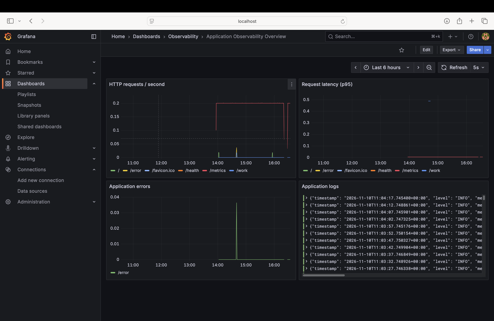
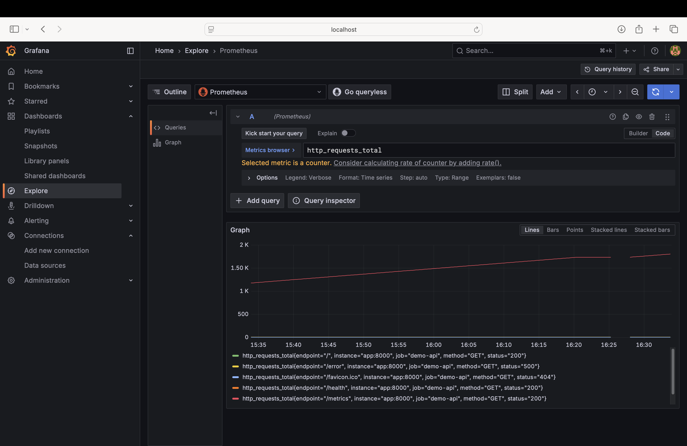
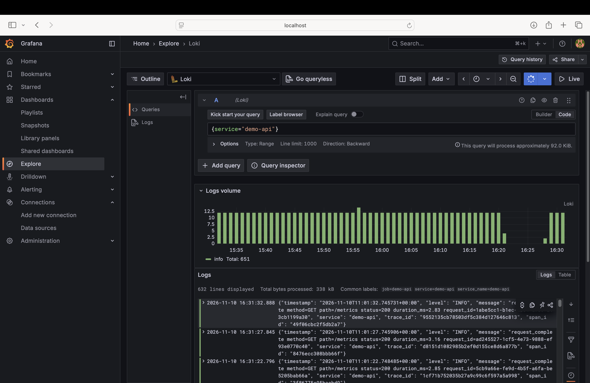
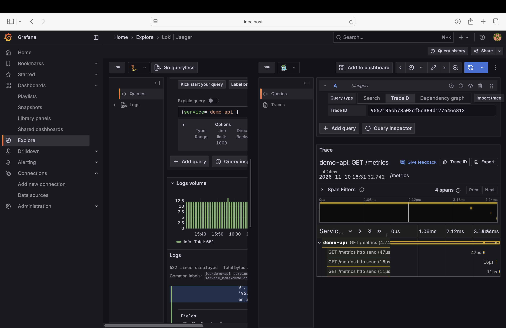

# Observability System – Project Report

## Objective
Build a Docker Compose environment that correlates application metrics, centralized logs and distributed traces.

## Architecture

- FastAPI exposes `/metrics`; Prometheus scrapes it every 5 seconds.
- The app writes structured JSON logs to a shared volume.
- Grafana Alloy tails the log file and pushes entries to Loki.
- OpenTelemetry instrumentation and the OTLP exporter send traces through the OpenTelemetry Collector to Jaeger.
- Grafana is provisioned with Prometheus, Loki and Jaeger data sources and an overview dashboard.

## Start the environment
Run from the project root:

```bash
docker compose up --build -d
docker compose ps
```

Open:
- API: http://localhost:8000
- Grafana: http://localhost:3000 (admin / admin)
- Prometheus: http://localhost:9090
- Jaeger: http://localhost:16686
- Loki readiness: http://localhost:3100/ready

## Generate test traffic

```bash
curl http://localhost:8000/
curl http://localhost:8000/work
curl http://localhost:8000/health
curl http://localhost:8000/error
```

The `/error` route intentionally raises an exception to demonstrate error logging and trace investigation. An HTTP 500 is expected.

## Deliverables
- `docker-compose.yml`: all services and networking
- `grafana/dashboards/observability-overview.json`: provisioned Grafana dashboard
- `app/main.py`: custom metrics, JSON logs and tracing
- `REPORT.md`: this report

## Example log shape
The application writes one JSON object per line. Example (IDs are illustrative):

```json
{"timestamp":"2026-11-10T08:00:00+00:00","level":"INFO","message":"request_complete method=GET path=/work status=200 duration_ms=184.21 request_id=example","service":"demo-api","trace_id":"0123456789abcdef0123456789abcdef","span_id":"0123456789abcdef"}
```

## Insights to investigate
These are hypotheses to validate after generating traffic, not measured results:
1. A rise in `rate(http_requests_total[1m])` indicates increased request volume.
2. A rise in p95 latency can indicate slower application work or downstream dependencies.
3. The `/error` endpoint should produce error logs and an increment in `app_errors_total`.
4. Jaeger should show request spans for `demo-api`; inspect the `business-work` span under `/work`.
5. Use the trace ID in structured logs to correlate a log entry with its distributed trace when trace context is available.

## Troubleshooting
- If Grafana has no metrics, check `http://localhost:9090/targets` and confirm `app:8000` is UP.
- If logs do not appear, check `docker compose logs alloy loki` and verify the shared volume contains `app.jsonl`.
- If traces do not appear, check `docker compose logs otel-collector jaeger app`; confirm OTLP ports 4317/4318 are reachable on the Compose network.
- Allow a short period after requests for batch exporters and log tailing to flush.

## Security and production notes
This is a learning environment. Change the default Grafana password, pin and regularly update images, add persistent storage and authentication, configure retention, resource limits and TLS, and avoid exposing observability ports publicly before production use.

## Screenshots






